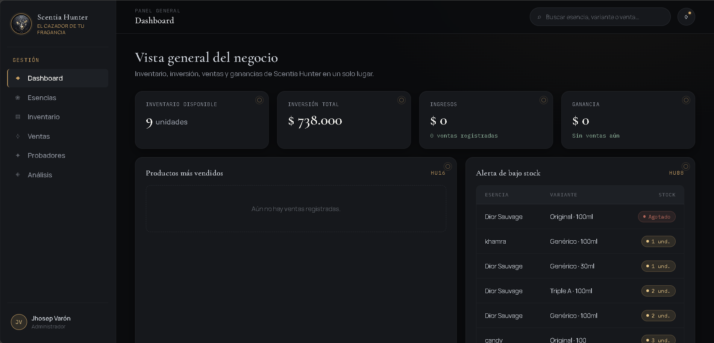

# Scentia Hunter — API Backend

API REST que guarda y calcula el inventario, las ventas, las ganancias y las estadísticas de un emprendimiento de perfumería.



- API en vivo (Azure App Service): https://scentia-hunter-back-jvaronm-e5hxf4gmgxc4a3e4.centralus-01.azurewebsites.net
- API en vivo (Vercel): https://scentia-hunter-backend-bgw1.vercel.app
- Frontend que la consume: https://github.com/Tosty144/scentia-hunter-frontend

La ruta `/` responde `{"message":"API Scentia Hunter lista y desplegada"}`; los datos están bajo `/api`.

## Modelo de datos

Cada esencia tiene variantes independientes, por ejemplo:

```
Dior Sauvage
 ├── Genérico · 30 ml   (costo, precio, stock)
 ├── Genérico · 100 ml
 ├── Triple A · 100 ml
 └── Original · 100 ml
```

Las ventas descuentan stock de la variante vendida y guardan ingreso y ganancia (ingreso menos costo).

## Endpoints

| Método | Ruta | Descripción |
|---|---|---|
| GET, POST | `/api/esencias` | Listar y crear esencias |
| GET, PUT, DELETE | `/api/esencias/:id` | Consultar, editar y eliminar una esencia |
| POST | `/api/esencias/:id/variantes` | Agregar una variante |
| PUT | `/api/esencias/:id/variantes/:varianteId` | Editar una variante |
| GET | `/api/esencias/probadores?estado=disponibles\|faltantes` | Esencias con o sin probador |
| POST | `/api/inventario/entradas` | Registrar entrada de stock |
| POST | `/api/inventario/salidas` | Registrar salida de stock |
| GET | `/api/inventario/movimientos` | Historial de movimientos |
| GET | `/api/inventario/bajo-stock` | Variantes bajo el umbral de stock |
| GET | `/api/inventario/inversion` | Inversión total en inventario |
| GET, POST | `/api/ventas` | Listar (filtro `desde`/`hasta`) y registrar ventas |
| GET | `/api/dashboard` | Indicadores generales |
| GET | `/api/analisis/ranking` | Productos más y menos vendidos |
| GET | `/api/analisis/sin-movimiento` | Esencias sin ventas en el periodo |
| GET | `/api/analisis/rentabilidad` | Ganancia por variante |

## Cómo ejecutarlo

Requisitos: Node.js 20 o superior y una base de datos MongoDB (por ejemplo, un clúster gratuito de MongoDB Atlas).

```bash
git clone https://github.com/Tosty144/scentia-hunter-backend.git
cd scentia-hunter-backend
npm install
cp .env.example atlas-credentials.env   # en Windows: copy .env.example atlas-credentials.env
# edita MONGODB_URI con tu cadena de conexión
npm run dev                             # API en http://localhost:4000 (o el PORT que definas)
```

| Comando | Para qué sirve |
|---|---|
| `npm start` | Inicia la API con Node |
| `npm run dev` | Inicia con recarga automática (nodemon) |
| `npm test` | Pruebas unitarias con Jest y Supertest |
| `npm run test:coverage` | Pruebas con cobertura en `out/coverage` |

Variables de entorno: `MONGODB_URI` (obligatoria), `PORT` y `UMBRAL_BAJO_STOCK`. Los archivos con credenciales (`atlas-credentials.env`, `.env*`) están en `.gitignore` y no se suben al repositorio. En Azure y Vercel se configuran como variables de entorno del servicio.

## Tecnologías

- Node.js, Express 4 y CORS
- MongoDB Atlas con Mongoose 8
- Jest, Supertest y Husky
- Despliegue en Azure App Service con Azure Pipelines (build, pruebas, SonarCloud y OWASP ZAP) y en Vercel
- Desarrollo en WSL (Ubuntu) con OpenCode como asistente de programación

## Estructura

```
server.js              # punto de entrada (app.listen fuera de Vercel)
src/
├── app.js             # Express, CORS y montaje de rutas
├── config/db.js       # conexión a MongoDB
├── models/            # Esencia (con variantes), Inventario, Venta
├── controllers/       # lógica de negocio por módulo
└── routes/            # endpoints
tests/                 # pruebas unitarias
.pipeline/             # pipeline de Azure DevOps
```

## Autor

Jhosep Varón

## Referencias

MongoDB. (s.f.). *Mongoose ODM*. https://mongoosejs.com

MongoDB. (s.f.). *MongoDB Atlas documentation*. https://www.mongodb.com/docs/atlas/

Microsoft. (s.f.). *Azure App Service documentation*. Microsoft Learn. https://learn.microsoft.com/en-us/azure/app-service/

Microsoft. (s.f.). *How to install Linux on Windows with WSL*. Microsoft Learn. https://learn.microsoft.com/en-us/windows/wsl/install

OpenCode. (s.f.). *OpenCode: The open source AI coding agent*. https://opencode.ai

OpenJS Foundation. (s.f.). *Express*. https://expressjs.com

OpenJS Foundation. (s.f.). *Jest*. https://jestjs.io

Vercel. (s.f.). *Vercel documentation*. https://vercel.com/docs
